  

### Hey, I'm Rege 👋

Full-stack developer. I build web apps, bots and tools, mostly in JavaScript and TypeScript.

<picture>
  <source media="(prefers-color-scheme: dark)" srcset="https://raw.githubusercontent.com/rege-ontop89/rege-ontop89/output/github-snake-dark.svg" />
  <source media="(prefers-color-scheme: light)" srcset="https://raw.githubusercontent.com/rege-ontop89/rege-ontop89/output/github-snake.svg" />
  
</picture>

<b>How the card is rated</b>

 

The card rebuilds itself every day from my GitHub activity. Ship more, rate higher.

| Stat | Means |
| --- | --- |
| **PAC** | contributions in the last 30 days |
| **SHO** | commits in the last year |
| **PAS** | pull requests opened and reviewed |
| **DRI** | longest daily contribution streak |
| **DEF** | issues opened and closed |
| **PHY** | languages and repos worked across |

Card tiers: bronze under 65, silver 65 to 74, gold 75 to 84, elite 85 and up.
The bars at the bottom are my form: contributions per week over the last 12 weeks.

